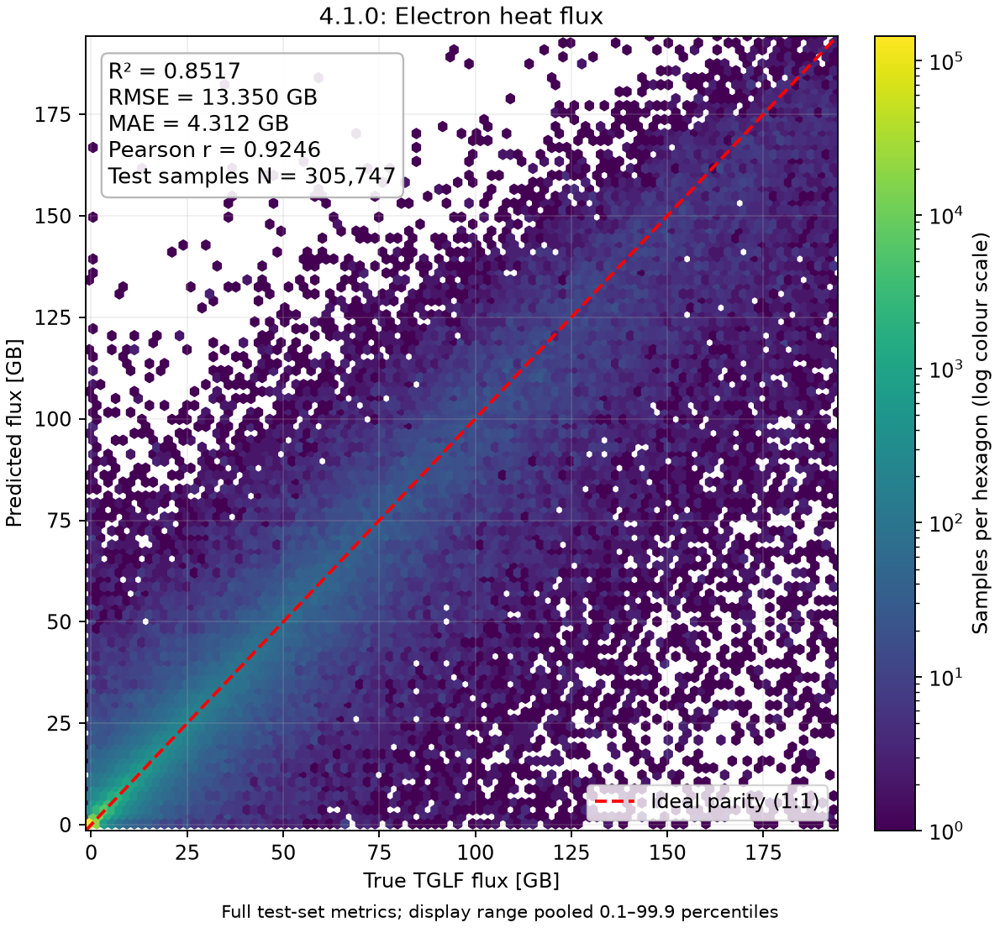
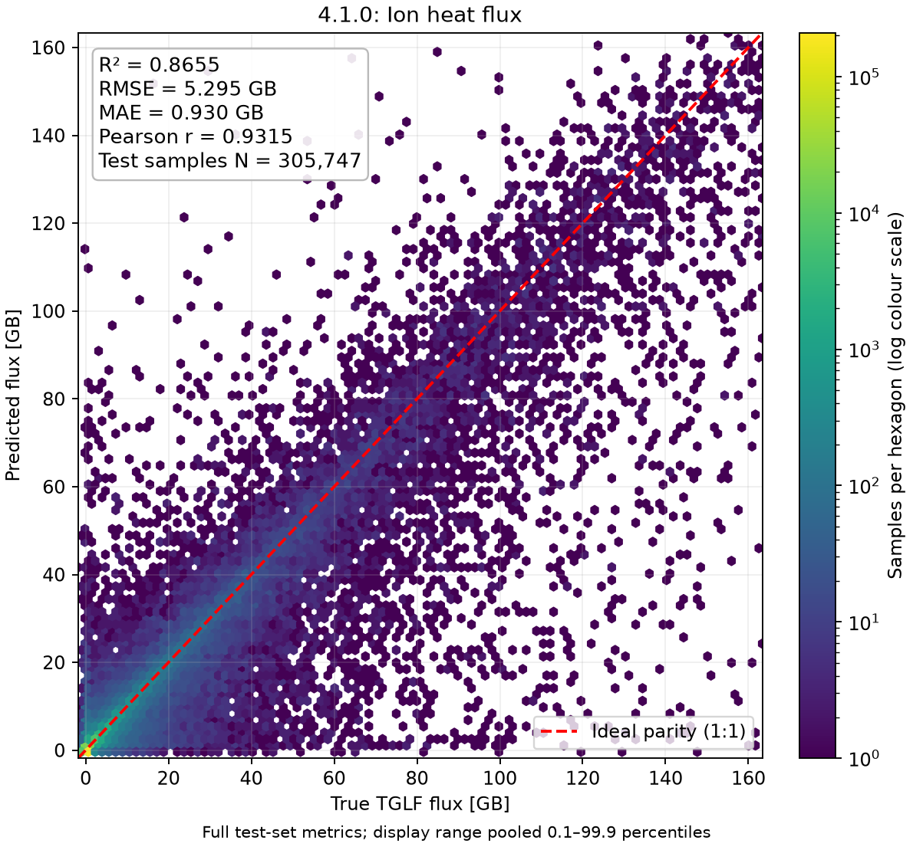
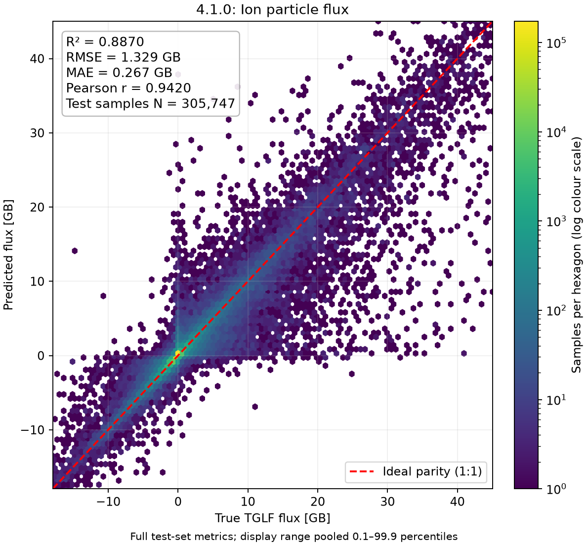
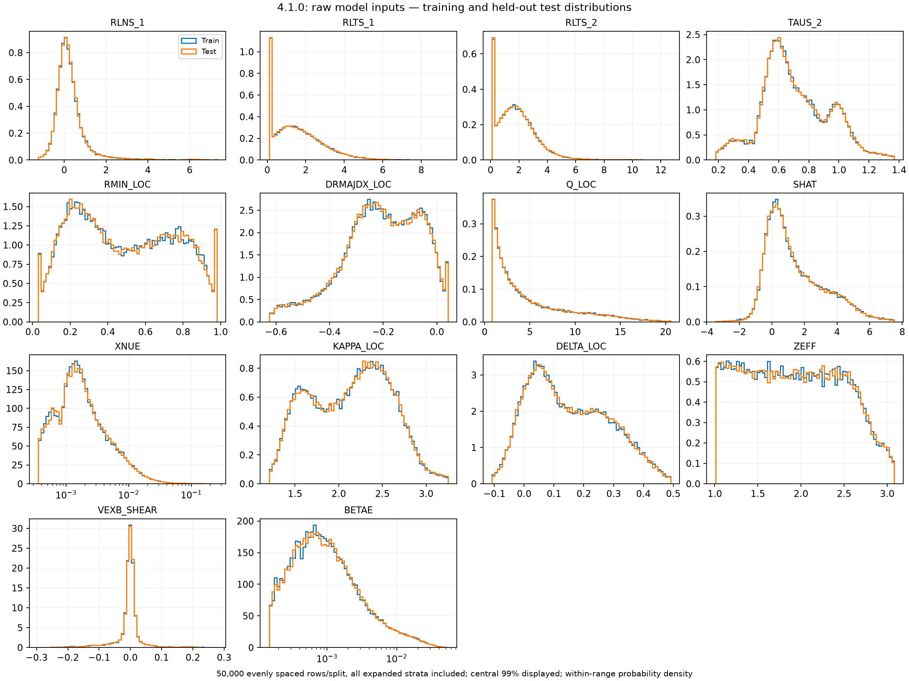
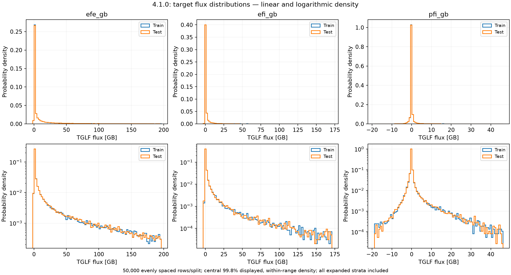

# STEP EM SAT1 — 4.1.0

Large five-member ensemble for STEP ramp-up and transition to flat-top. Single effective ion,
14 inputs; no separate D and T fluxes.
The relative `4.1.0` symlink selects this descriptive bundle directory.

## Model family

The three versions are size variants sharing the training splits, input/output
interface and reference physics. All use the same physical error-power correction
method, fitted separately for each version and flux.

| Version | Model per flux | TorchScript + ONNX download |
| --- | --- | ---: |
| [4.1.0](../STEP-effectiveion-EM-SAT1-14D-asinh1-large-ensemble5-9482b564f803/README.md) | Five large members: electron 1024×12, ion 1024×8, particle 768×12 | 2.36 GB, optional |
| [4.1.1](../STEP-effectiveion-EM-SAT1-14D-asinh1-arch512x8-ensemble5-6922c92623ea/README.md) | Five 512×8 members | 540 MB |
| [4.1.2](../STEP-effectiveion-EM-SAT1-14D-asinh1-arch512x8-single-7368dc3ea876/README.md) | One selected 512×8 member | 108 MB |

4.1.1 uses smaller backbones than 4.1.0. 4.1.2 selects the member of each 4.1.1
flux ensemble with the lowest validation Balanced MAE; its point forecast uses
that member, while uncertainty is corrected separately for the single model.
Each ensemble averages its five members with equal weights. Sizes above include
all three fluxes in both export formats. See each version's test scores when
choosing between size and accuracy; larger models need an explicit LFS download.

## Interface

Supply raw float32 `(batch,14)` inputs: `RLNS_1, RLTS_1, RLTS_2, TAUS_2, RMIN_LOC, DRMAJDX_LOC, Q_LOC, SHAT, XNUE, KAPPA_LOC, DELTA_LOC, ZEFF, VEXB_SHEAR, BETAE`.
Scaling is embedded. `regressor_{efe,efi,pfi}_gb_torchscript.pt` and matching
`.onnx` files return `(mean,variance)`, each `(batch,1)`, in GB and GB².
Heat means are floored at zero; particle means retain inward pinch.
The TCI adapter uses abs(Q_LOC) and applies ALPHA_E to ExB shear.

Older bundles included `scaler.pkl` as a record of training normalization. These
TorchScript/ONNX exports include input scaling and output inverse transforms
internally; the values are documented in per-flux `config.yaml`. Supply raw
inputs: no separate scaler file or manual normalization is needed.

## Training and evaluation

Each flux uses 29,991,834 training, 306,356 validation and 305,747 test rows.
Validation selects checkpoints; test rows are excluded from training.

| Flux | Width × residual blocks, activation | Members | Completed epochs/member | Selected epochs |
| --- | --- | ---: | ---: | --- |
| efe_gb | 1024 × 12 mish | 5 | 20 | 14, 18, 18, 18, 17 |
| efi_gb | 1024 × 8 mish | 5 | 30 | 27, 18, 23, 24, 20 |
| pfi_gb | 768 × 12 gelu | 5 | 60 | 58, 56, 59, 60, 60 |

Per-flux `config.yaml` contains hyperparameters, seeds, embedded scaling and
empirical interval multipliers. Post-training uncertainty correction leaves the
selected point predictions unchanged.

Full test-set scores (305,747 rows per channel; no outcome or input cuts):

| Flux | R² | RMSE [GB] | MAE [GB] |
| --- | ---: | ---: | ---: |
| efe_gb | 0.8517 | 13.35 | 4.312 |
| efi_gb | 0.8655 | 5.295 | 0.9297 |
| pfi_gb | 0.8870 | 1.329 | 0.2667 |

[Full metrics](production_metrics.json) cover the validation and test splits.

## Uncertainty and limits

Variance estimates physical squared prediction error. Empirical intervals use
`mean ± q × sqrt(variance)`, with magnitude-band `q68`/`q95` from each config.
These multipliers do not define a calibrated Gaussian density.

On 13,300 fresh reference rows excluded from training:

| Flux | Empirical 68% coverage | Empirical 95% coverage |
| --- | ---: | ---: |
| efe_gb | 67.4% | 95.5% |
| efi_gb | 67.4% | 95.3% |
| pfi_gb | 60.9% | 93.8% |

Calibration remains incomplete in particle and low-electron regions; conditional
variance does not always track error power. Generalization to other discharges
is not established. The advisory [input warning](input_warning.json) is not wired
into inference. Detailed evaluation and provenance are retained in the linked
builder source archive.

Reference settings are SAT1, NS=2, MASS_2=2.5, NBASIS_MIN=2 and NBASIS_MAX=10:
[settings](tglf_settings.json), [common input](common_STEP_ramp_flat_top.tglf).
These are effective-ion references, distinct from native multi-ion transport.

## Figures and source

The parity plots above use the test split. [Validation parity](plots/parity_validation.png)
uses the separate split used to select checkpoints; the [low-flux test zoom](plots/parity_low_flux_test.png)
shows a subset of the test split. Hexbin metrics use the full test split; display
limits are the pooled 0.1–99.9 percentiles. Panel plots display at most 30,000
sampled points/channel with symmetric-log axes, linear within ±0.1 GB. Low-flux
plots select |reference| ≤0.1 GB. Distribution plots sample 50,000 rows from each
training/test split, including expanded strata: central 99% for inputs, 99.8% for
flux targets, with densities normalized within those ranges. XNUE and BETAE use
log x axes; the lower flux panels use log density axes.

[Source and detailed provenance, builder tag `4.1.0`](https://gitlab.ukaea.uk/pr5739/tglf-surrogate-builder/-/tree/4.1.0/surrogate_models/release-series-20261013/4.1.0).
Runtime files were copied unchanged and checked across TorchScript, ONNX and native TCI.
After downloading Git LFS payloads, run `sha256sum -c SHA256SUMS`.
See the repository README for default and optional downloads.
