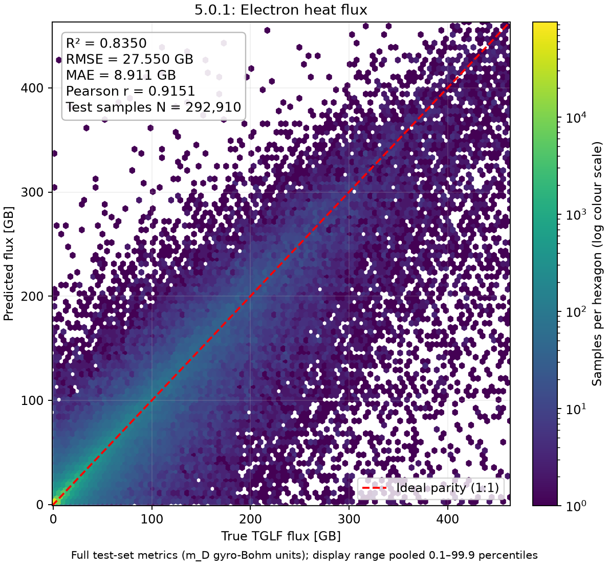
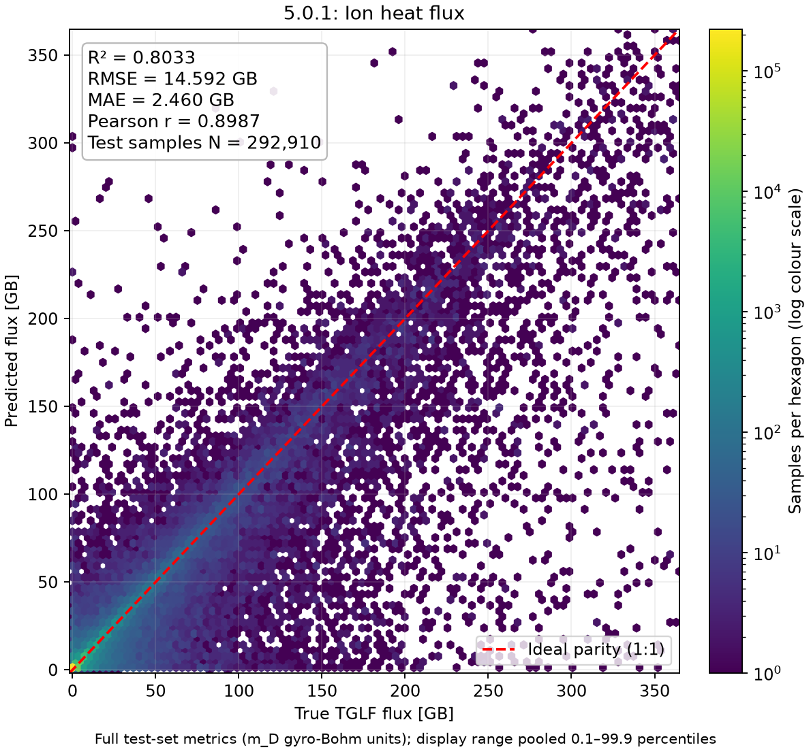
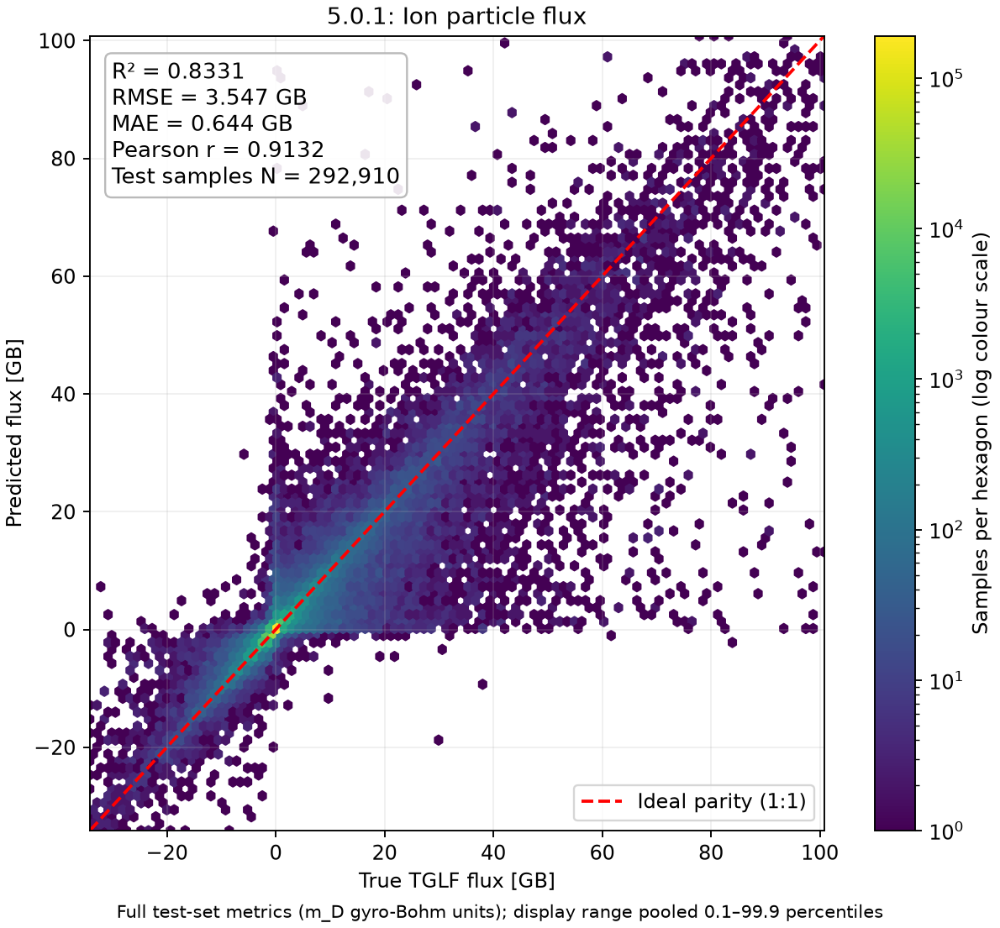

# STEP EM SAT1 (16D, Deuterium Mass Units) — 5.0.1

Medium five-member (`512×8`) 16D ensemble for STEP electromagnetic ramp-up and flat-top transport modelling.
The relative `5.0.1` symlink selects this content-hashed bundle directory.

This bundle shares its 16-input interface, 30M training/validation/test splits, physics settings, uncertainty
calibration method, and advisory domain guard with the rest of the `5.0.x` family. **See the
[shared 5.0.x README](../STEP-effectiveion-EM-SAT1-16D-asinh1-large-ensemble5-c2cdba9dc173/README.md) for full
documentation** and the shared
[input distributions](../STEP-effectiveion-EM-SAT1-16D-asinh1-large-ensemble5-c2cdba9dc173/plots/input_distributions.png)
and [flux distributions](../STEP-effectiveion-EM-SAT1-16D-asinh1-large-ensemble5-c2cdba9dc173/plots/flux_distributions.png).

## Architecture

| Flux | Width × residual blocks, activation | Members | Completed epochs/member | Selected epochs |
| --- | --- | ---: | ---: | --- |
| efe_gb | 512 × 8 mish | 5 | 25 | 23, 25, 21, 22, 24 |
| efi_gb | 512 × 8 mish | 5 | 30 | 27, 28, 26, 20, 28 |
| pfi_gb | 512 × 8 gelu | 5 | 60 | 51, 56, 57, 44, 52 |

## Held-out test-set scores and coverage

Evaluated across the full 292,910-row held-out test split (no regions or high-flux tails filtered out;
[full metrics](production_metrics.json)):

| Flux | R² | RMSE [GB] | MAE [GB] | Empirical 68% coverage | Empirical 95% coverage |
| --- | ---: | ---: | ---: | ---: | ---: |
| efe_gb | 0.8350 | 27.55 | 8.911 | 68.5% | 95.1% |
| efi_gb | 0.8033 | 14.59 | 2.46 | 68.1% | 94.9% |
| pfi_gb | 0.8331 | 3.547 | 0.6436 | 67.9% | 94.8% |

## Parity figures and checksums

[Source and detailed provenance, builder tag `5.0.1`](https://gitlab.ukaea.uk/pr5739/tglf-surrogate-builder/-/tree/5.0.1/surrogate_models/v42-5.0-series-20261117/5.0.1). Verify LFS payloads via `sha256sum -c SHA256SUMS`.
