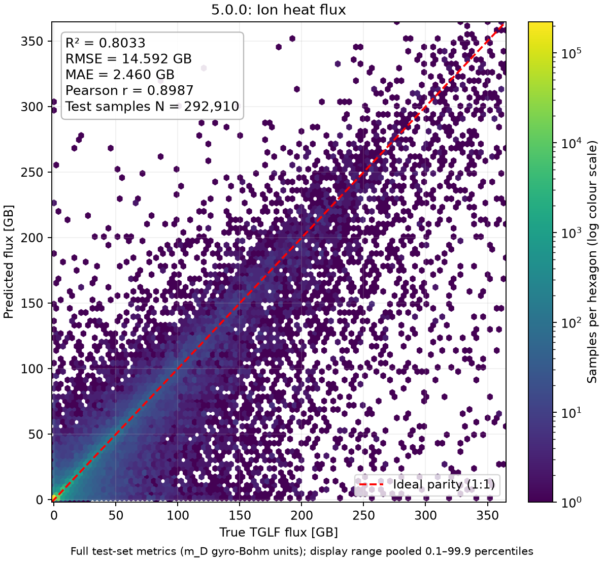
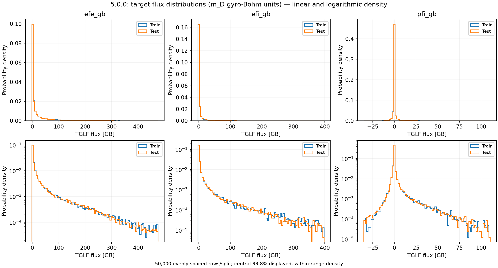

# STEP EM SAT1 (16D, Deuterium Mass Units) — 5.0.x Family (`5.0.0`)

16D neural network surrogates for STEP electromagnetic ramp-up and flat-top transport modelling.
Single effective DT50 ion (`MASS_2 = 1.25`, `MASS_1 = 0.0002723` in deuterium mass units $m_D$),
16 raw physical inputs including explicit elongation and triangularity shear (`S_KAPPA_LOC`, `S_DELTA_LOC`);
no separate D and T species channels.

This directory (`5.0.0` symlink) holds the **large five-member ensemble (`5.0.0`)** and the shared
documentation and dataset distribution plots for the entire `5.0.x` series. See the version-specific
READMEs for [5.0.1](../STEP-effectiveion-EM-SAT1-16D-asinh1-arch512x8-ensemble5-ed083e5f1bea/README.md)
and [5.0.2](../STEP-effectiveion-EM-SAT1-16D-asinh1-arch512x8-single-e5ab7d902649/README.md) for their
per-version architectures, scores, and parity plots.

## Model family

The three `5.0.x` versions are size variants sharing the exact same training/validation/test splits,
16-input/output interface, and reference TGLF physics:

- **`5.0.0`** (this bundle): five large residual-MLP members per flux (`768×10` electron heat, `512×8` ion heat, `768×12` particle); excluded from default Git LFS fetch because of size (`1.27 GB`, pull explicitly via `git lfs pull -I "STEP-effectiveion-EM-SAT1-16D-asinh1-large-ensemble5-c2cdba9dc173/**"`).
- **[`5.0.1`](../STEP-effectiveion-EM-SAT1-16D-asinh1-arch512x8-ensemble5-ed083e5f1bea/README.md)**: five `512×8` members per flux (`540 MB`).
- **[`5.0.2`](../STEP-effectiveion-EM-SAT1-16D-asinh1-arch512x8-single-e5ab7d902649/README.md)**: single `512×8` member per flux selected from `5.0.1` by lowest validation Balanced MAE (`108 MB`; also distributed as pure-NumPy `.npz` weights in the `tglfnn_ukaea` Python package).

Each five-member ensemble averages its members with equal weights. After training, a separate
variance-calibration step rescales only the predicted variance into physical `GB²` units while
keeping the trained backbone weights frozen (so the predicted `mean` flux is unchanged).

| Version | Model per flux | TorchScript + ONNX download |
| --- | --- | ---: |
| **5.0.0** (this bundle) | Five large members: electron 768×10, ion 512×8, particle 768×12 | 1.27 GB, optional LFS |
| [5.0.1](../STEP-effectiveion-EM-SAT1-16D-asinh1-arch512x8-ensemble5-ed083e5f1bea/README.md) | Five 512×8 members per flux | 540 MB |
| [5.0.2](../STEP-effectiveion-EM-SAT1-16D-asinh1-arch512x8-single-e5ab7d902649/README.md) | One selected 512×8 member per flux | 108 MB |

## Interface

Supply raw float32 `(batch, 16)` inputs in exact order:
`RLNS_1, RLTS_1, RLTS_2, TAUS_2, RMIN_LOC, DRMAJDX_LOC, Q_LOC, SHAT, XNUE, KAPPA_LOC, S_KAPPA_LOC, DELTA_LOC, S_DELTA_LOC, ZEFF, VEXB_SHEAR, BETAE`.

- **Embedded scaling:** `log10` transforms on `XNUE` and `BETAE` (floored at `1e-8`), input standardisation,
  and inverse target scaling are embedded inside the computation graph; supply raw physical quantities without
  external scaler files.
- **Sign and ExB conventions (all callers):** The network was trained with `Q_LOC > 0` and effective ExB
  shear. Any caller (Python, ONNX, FTorch, or transport codes) must supply `abs(Q_LOC)` and pass
  `ALPHA_E * VEXB_SHEAR` into the `VEXB_SHEAR` input slot (matching how TGLF applies `ALPHA_E` internally).
  In JINTRAC, the 16-input `case(5)` TCI adapter (`ITRTGLFNN_VER = 5, 0, x`) implements this mapping and
  passes `S_KAPPA_LOC` and `S_DELTA_LOC`.
- **Trapped-particle angle:** `THETA_TRAPPED` is not a separate model input; reference TGLF evaluations
  prescribe it deterministically from local inverse aspect ratio via
  `THETA_TRAPPED = 1 - clip(sqrt(RMIN_LOC / RMAJ_LOC), 0.3, 0.7)` with `RMAJ_LOC = 2.0` (matching the STEP
  SPP3 aspect ratio convention in JINTRAC `TCI_tglf`).
- **Outputs:** `regressor_{efe,efi,pfi}_gb_torchscript.pt` and matching `.onnx` (opset 17) files return
  `(mean, variance)`, each `(batch, 1)`, in `GB` and `GB²` ($m_D$ units). Heat means are clamped at `>= 0`;
  particle means preserve signed inward pinch.

## Training data, architecture, and evaluation

The 30M-point parameter space combines native STEP SPP1, SPP2, and SPP3 ramp-up and flat-top trajectories
(from JETTO-TGLF, JETTO-BgB, and JETTO-TGLFNN simulations) with screened space-filling and tail expansions
covering the STEP operating envelope. Each flux uses 28,730,550 training, 293,527 validation, and 292,910
held-out test rows generated with `SAT_RULE = 1`, `KYGRID_MODEL = 4`, `NBASIS_MIN = 2`, `NBASIS_MAX = 10`,
`WIDTH = 1.9`, `WIDTH_MIN = 0.495` ([tglf_settings.json](tglf_settings.json),
[common_STEP_em_v42.tglf](common_STEP_em_v42.tglf)).

Splits retain converged simulations within physical flux bounds (`efe_gb, efi_gb in (-10, 500] GB`,
`|pfi_gb| <= 500 GB`), screening out extreme non-physical quasilinear blow-ups (`> 500 GB`) while retaining
stiff bursts up to `500 GB`. Small negative heat fluxes (`(-10, 0) GB`) are intentionally kept during training
so the network learns a smooth transition through zero and sharper near-threshold slopes before post-prediction
clamping (`max(0, mean)`).

Backbones train in standardised `asinh(y / 1.0 GB)` space — linear for `|y| << 1 GB` (preserving smooth
near-threshold behaviour and signed particle pinch) and logarithmic for `|y| >> 1 GB` (preventing
multi-hundred-GB bursts from dominating gradients) — using Huber loss on the mean plus detached-mean Gaussian
NLL on the variance head so stiff slopes are not damped by large local uncertainty. Each backbone is a
pre-LayerNorm residual MLP: an input linear layer followed by a stack of **residual blocks**
(`x + Linear(act(Linear(LayerNorm(x))))`), a final `LayerNorm`, and separate two-layer mean and variance heads.

### `5.0.0` architecture and test-set metrics

| Flux | Width × residual blocks, activation | Members | Completed epochs/member | Selected epochs |
| --- | --- | ---: | ---: | --- |
| efe_gb | 768 × 10 mish | 5 | 25 | 19, 19, 17, 17, 21 |
| efi_gb | 512 × 8 mish | 5 | 30 | 27, 28, 26, 20, 28 |
| pfi_gb | 768 × 12 gelu | 5 | 60 | 55, 53, 48, 56, 52 |

Per-flux `config.yaml` records hyperparameters, seeds, embedded scaling parameters, and empirical interval multipliers.

Held-out test-set scores evaluated across the entire 292,910-row test split (including stiff high-flux tails
up to `500 GB`, without filtering out hard regions):

| Flux | R² | RMSE [GB] | MAE [GB] |
| --- | ---: | ---: | ---: |
| efe_gb | 0.8419 | 26.97 | 8.612 |
| efi_gb | 0.8033 | 14.59 | 2.46 |
| pfi_gb | 0.8316 | 3.562 | 0.6385 |

The full-space `R²` (`0.78–0.84` across `5.0.x`) is dominated by stiff electromagnetic bursts near the `500 GB`
ceiling; on realistic STEP operating profiles (held-out `P16` ramp-up and out-of-sample `DIND4` ramp), `5.0.0`
and `5.0.1` reach `R² = 0.89–0.996`, and coupled flux-driven JINTRAC replays (`P16`, `BC13` flat-top, rotating
`SPP2`) match native TGLF closely (e.g. `BC13` core MAE `0.21 keV` $T_e$, `0.16 keV` $T_i$).
[Full metrics](production_metrics.json) cover both validation and test splits.

## Uncertainty, domain guard, and limits

Because raw ensemble variance in `asinh` space does not map linearly to physical error power across four orders
of magnitude, a post-hoc ridge-regularised log-linear correction
`variance = v_raw * exp(eta(x, mean, v_raw))` (30 features: standardised inputs, `log|mean|`, `log(v_raw)`,
piecewise-linear flux-magnitude basis, and outer-core / low-`BETAE` indicators) is fitted by Gaussian NLL on
10,000 fresh independent TGLF simulations with all backbone weights frozen (`0.0` float32 change to `mean`).
Calibration robustness is verified on both a separate untouched 5,000-row assessment split and the 292,910-row
test split, where overall empirical 68%/95% coverage stays within ~1 percentage point of target.

Because turbulent flux residuals are heavy-tailed rather than Gaussian, `mean ± 1σ` does not automatically
give 68% coverage in every flux regime. Downstream tools or uncertainty diagnostics that want calibrated
confidence intervals can multiply `sqrt(variance)` by the magnitude-band multipliers `q68`/`q95`
(`<=0.1`, `(0.1, 1]`, `(1, 10]`, `>10 GB`) recorded in per-flux `config.yaml` (`mean ± q × sqrt(variance)`).

On the 5,000-row independent assessment simulations (`5.0.0`):

| Flux | Empirical 68% coverage | Empirical 95% coverage |
| --- | ---: | ---: |
| efe_gb | 69.3% | 94.7% |
| efi_gb | 68.1% | 94.9% |
| pfi_gb | 69.0% | 94.8% |

The advisory [input warning](input_warning.json) is a shallow decision tree of single-variable threshold splits
(including `log10(BETAE)`) trained to flag out-of-domain inputs likely to trigger `> 500 GB` TGLF blow-ups
(`~9.9%` in-target false-positive rate). For coupled transport solvers with TGLF fallback capability, combine
`input_warning.json` with relative uncertainty `sqrt(variance) / max(abs(mean), 0.5 GB) >= 0.75`.

## Figures and checksums

Hexbin parity plots evaluate the full held-out test split (292,910 rows per channel, including expanded tail
strata) with pooled 0.1–99.9 percentile display limits and logarithmic bin-count colour scales. The shared
input and flux distribution plots sample 50,000 evenly spaced rows per split across the `5.0.x` dataset
(all strata included), showing the central 99% of inputs (`XNUE` and `BETAE` on log x-axes) and central 99.8%
of target fluxes (linear and log density axes).

[Source and detailed provenance, builder tag `5.0.0`](https://gitlab.ukaea.uk/pr5739/tglf-surrogate-builder/-/tree/5.0.0/surrogate_models/v42-5.0-series-20261117/5.0.0). Verify LFS payloads via `sha256sum -c SHA256SUMS`.
