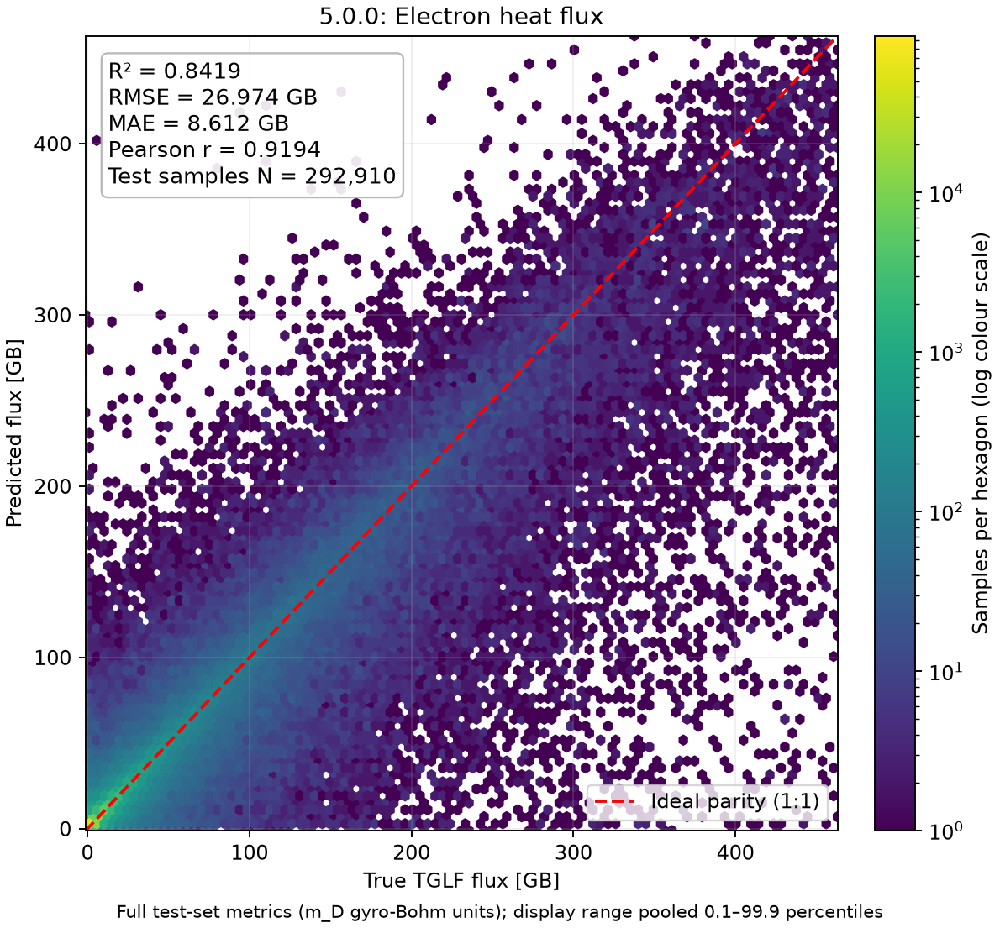
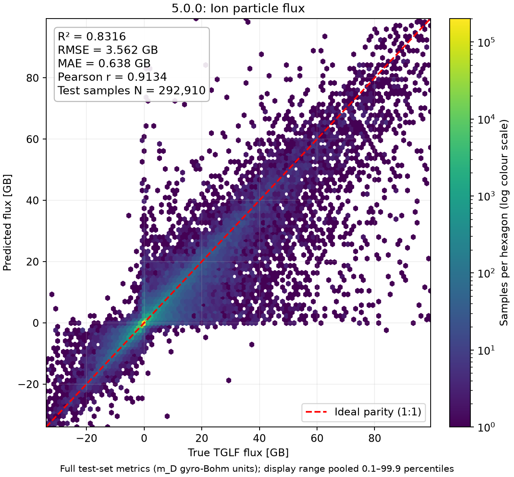
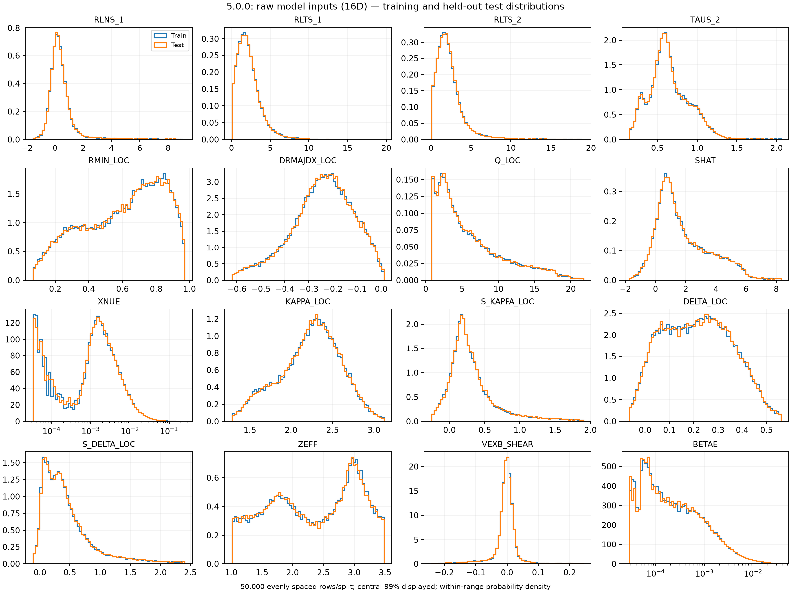

# STEP EM SAT1 (16D, Deuterium Mass Units) — 5.0.0

Large five-member 16D ensemble for STEP electromagnetic ramp-up and flat-top transport modelling.
Single effective DT50 ion (`MASS_2 = 1.25`, `MASS_1 = 0.0002723` in deuterium mass units $m_D$),
16 raw physical inputs including explicit elongation and triangularity shear (`S_KAPPA_LOC`, `S_DELTA_LOC`);
no separate D and T species channels.
The relative `5.0.0` symlink selects this content-hashed bundle directory.

## Model family

The three `5.0.x` versions are size variants sharing the training splits, 16-input/output interface,
and reference physics. `5.0.1` uses `512×8` backbones across all fluxes; `5.0.2` selects the `5.0.1`
member per flux with the lowest validation Balanced MAE. Each five-member ensemble averages its members
with equal weights. Post-training physical error-power calibration is fitted separately for each version
and flux while leaving point predictions unchanged. Sizes below cover all three fluxes in both TorchScript
and ONNX formats; `5.0.0` requires an explicit Git LFS pull.

| Version | Model per flux | TorchScript + ONNX download |
| --- | --- | ---: |
| [5.0.0](../STEP-effectiveion-EM-SAT1-16D-asinh1-large-ensemble5-c2cdba9dc173/README.md) | Five large members: electron 768×10, ion 512×8, particle 768×12 | 1.27 GB, optional LFS |
| [5.0.1](../STEP-effectiveion-EM-SAT1-16D-asinh1-arch512x8-ensemble5-ed083e5f1bea/README.md) | Five 512×8 members per flux | 540 MB |
| [5.0.2](../STEP-effectiveion-EM-SAT1-16D-asinh1-arch512x8-single-e5ab7d902649/README.md) | One selected 512×8 member per flux | 108 MB |

## Interface

Supply raw float32 `(batch, 16)` inputs in exact order:
`RLNS_1, RLTS_1, RLTS_2, TAUS_2, RMIN_LOC, DRMAJDX_LOC, Q_LOC, SHAT, XNUE, KAPPA_LOC, S_KAPPA_LOC, DELTA_LOC, S_DELTA_LOC, ZEFF, VEXB_SHEAR, BETAE`.

Input `log10` transforms (`XNUE`, `BETAE`, floored at `1e-8`) and standardisation, together with inverse target
scaling, are embedded inside the computation graph; supply raw physical quantities without external scaler files.
`THETA_TRAPPED` is not a separate model input: reference TGLF evaluations prescribe it deterministically from local
inverse aspect ratio via `THETA_TRAPPED = 1 - clip(sqrt(RMIN_LOC / RMAJ_LOC), 0.3, 0.7)` with `RMAJ_LOC = 2.0`,
matching JINTRAC `TCI_tglf`.

`regressor_{efe,efi,pfi}_gb_torchscript.pt` and matching `.onnx` (opset 17) files return `(mean, variance)`,
each `(batch, 1)`, in `GB` and `GB²` ($m_D$ units). Heat means are clamped at `>= 0`; particle means preserve
signed inward pinch. Requires the 16-input `case(5)` JINTRAC TCI adapter (`ITRTGLFNN_VER = 5, 0, x`), which
passes `S_KAPPA_LOC` and `S_DELTA_LOC` alongside `abs(Q_LOC)` and `ALPHA_E`-scaled `VEXB_SHEAR`.

## Training and evaluation

Each flux uses 28,730,550 training, 293,527 validation and 292,910 excluded test rows
generated with `SAT_RULE = 1`, `KYGRID_MODEL = 4`, `NBASIS_MIN = 2`, `NBASIS_MAX = 10`, `WIDTH = 1.9`, `WIDTH_MIN = 0.495`
([tglf_settings.json](tglf_settings.json), [common_STEP_em_v42.tglf](common_STEP_em_v42.tglf)).
Splits retain converged simulations within physical flux bounds (`efe_gb, efi_gb in (-10, 500] GB`,
`|pfi_gb| <= 500 GB`), screening out extreme non-physical quasilinear blow-ups (`> 500 GB`) far above tokamak
power-balance operating points while retaining stiff bursts up to `500 GB`.

Backbones train in standardised `asinh(y / 1.0 GB)` space — linear for `|y| << 1 GB` (preserving smooth near-threshold
behaviour and signed particle pinch) and logarithmic for `|y| >> 1 GB` (preventing multi-hundred-GB bursts from
dominating gradients) — using Huber loss on the mean plus detached-mean Gaussian NLL on the variance head so stiff
slopes are not damped by large local uncertainty.

| Flux | Width × residual blocks, activation | Members | Completed epochs/member | Selected epochs |
| --- | --- | ---: | ---: | --- |
| efe_gb | 768 × 10 mish | 5 | 25 | 19, 19, 17, 17, 21 |
| efi_gb | 512 × 8 mish | 5 | 30 | 27, 28, 26, 20, 28 |
| pfi_gb | 768 × 12 gelu | 5 | 60 | 55, 53, 48, 56, 52 |

Per-flux `config.yaml` records hyperparameters, seeds, embedded scaling parameters, and empirical interval multipliers.

Full held-out test-set scores (292,910 rows per channel; no outcome or input cuts within the `<= 500 GB` dataset):

| Flux | R² | RMSE [GB] | MAE [GB] |
| --- | ---: | ---: | ---: |
| efe_gb | 0.8419 | 26.97 | 8.612 |
| efi_gb | 0.8033 | 14.59 | 2.46 |
| pfi_gb | 0.8316 | 3.562 | 0.6385 |

[Full metrics](production_metrics.json) cover both validation and test splits.

## Uncertainty, domain guard and limits

Raw `asinh`-space ensemble and heteroscedastic variance is mapped to physical `GB²` via a post-hoc log-linear scale
correction fitted on held-out reference simulations with the point-prediction weights frozen (`0.0` float32 change to
`mean`). Because turbulent flux residuals are heavy-tailed, empirical intervals use `mean ± q × sqrt(variance)` with
magnitude-band multipliers `q68`/`q95` (`<=0.1`, `(0.1, 1]`, `(1, 10]`, `>10 GB`) recorded in per-flux `config.yaml`.
These multipliers provide empirical interval calibration rather than a Gaussian density guarantee.

On fresh independent reference simulations excluded from training and calibration fitting:

| Flux | Empirical 68% coverage | Empirical 95% coverage |
| --- | ---: | ---: |
| efe_gb | 69.3% | 94.7% |
| efi_gb | 68.1% | 94.9% |
| pfi_gb | 69.0% | 94.8% |

The advisory [input warning](input_warning.json) uses `LOG10_BETAE`-aware axis rules (`~9.9%` in-target false-positive rate).
For coupled transport solvers with TGLF fallback capability, combine `input_warning.json` with relative uncertainty
`sqrt(variance) / max(abs(mean), 0.5 GB) >= 0.75` to catch high-disagreement out-of-distribution states.

## Figures and checksums

Hexbin parity plots evaluate the full held-out test split (292,910 rows per channel, including expanded tail strata)
with pooled 0.1–99.9 percentile display limits and logarithmic bin-count colour scales. Distribution plots sample
50,000 evenly spaced rows per split (all strata included), showing the central 99% of inputs (`XNUE` and `BETAE` on
log x-axes) and central 99.8% of target fluxes (linear and log density axes).

[Source and detailed provenance, builder tag `5.0.0`](https://gitlab.ukaea.uk/pr5739/tglf-surrogate-builder/-/tree/5.0.0/surrogate_models/v42-5.0-series-20261117/5.0.0). Verify LFS payloads via `sha256sum -c SHA256SUMS`.
